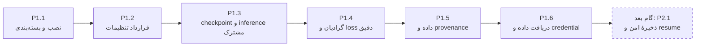
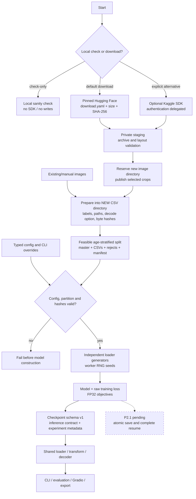

# گزارش اجرای فاز اول: صحت، بازتولیدپذیری و قابلیت اعتماد

- تاریخ: ۲۰۲۶-۱۱-۰۶، Asia/Tehran
- مخزن: [Facial_Age_estimation_PyTorch](https://github.com/Ebimsv/Facial_Age_estimation_PyTorch)
- دامنه: P1.1 تا P1.6 از [نقشهٔ راه](IMPLEMENTATION_ROADMAP.md)؛ مبنای ممیزی `a2c3a4e`
- کامیت پایان اولیهٔ P1.6: [`31216d5`](https://github.com/Ebimsv/Facial_Age_estimation_PyTorch/commit/31216d5)

- تکمیل دانلود Hugging Face پیش از فاز دوم: [`b09a79a`](https://github.com/Ebimsv/Facial_Age_estimation_PyTorch/commit/b09a79a)؛ جزئیات جاری در بخش ۹.

> وضعیت پس از این گزارش: P2.1 اکنون پیاده‌سازی شده است؛ **۳۷۷ تست کامل محلی موفق**.
> ذخیرهٔ امن، epoch-boundary resume، AMP scheduling و logging در
> [TRAINING.md](../docs/TRAINING.md) و ثبت جاری [نقشهٔ راه](IMPLEMENTATION_ROADMAP.md)
> آمده‌اند. اخطارهای P2.1 در متن زیر، وضعیت تاریخی پایان فاز اول را ثبت می‌کنند؛
> best deletion در نسخهٔ جدید رفع شده است. گام بعدی اکنون P2.2 است.
> CI کد نهایی P2.1 (`4530886`) نیز روی Python 3.10/3.11/3.12 و lint موفق شد؛
> [شاهد ریموت](https://github.com/Ebimsv/Facial_Age_estimation_PyTorch/actions/runs/42286680309).

## ۱. نتیجهٔ فاز اول

هر شش گام برنامهٔ فاز اول در کد و تست پیاده‌سازی شدند. پروژه اکنون بستهٔ قابل نصب،
config معتبر، قرارداد مشترک checkpoint/inference، گرادیان صحیح رگرسیون، loss با تعریف
دقیق و محاسبات FP32، protocol قابل پیگیری داده و downloader با مقصد محافظت‌شده دارد.
در پایان اولیهٔ P1.6، **۲۶۸ تست محلی موفق بودند**؛ شامل دو تست واقعی AMP/CUDA. CI آن گام
نهایی نیز برای کامیت `d821247` موفق شد؛ شاهد ریموت در انتهای سند آمده است.

این فاز مدل تازه‌ای آموزش نداده، MAE یا latency جدیدی اندازه نگرفته و split تاریخی
را بازسازی نکرده است. دانلود واقعی از Kaggle، کیفیت annotation، near-duplicate و
نشت هویتی هنوز تأیید نشده‌اند. فاز اول زیرساخت و correctness را اصلاح کرده است؛
پایان آن به معنی تکمیل resume، deployment یا benchmark نهایی پروژه نیست.

## ۲. شش گام و حاصل قابل مشاهدهٔ هرکدام

| گام | مشکل پیش از اصلاح | رفتار نهایی و شاهد اصلی |
|---|---|---|
| P1.1 | backend/discovery بسته و دسترسی config در نصب مستقل مشکل داشت | wheel و sdist ساخته و wheel بازساخته‌شده بیرون checkout نصب شد؛ سه CLI و resource YAML کار می‌کنند. `tests/test_packaging.py` |
| P1.2 | typo، interpolation یا ترکیب loss/output نامعتبر دیر شناسایی می‌شد؛ برخی تنظیمات بی‌اثر بودند | schema typed/read-only، merge نهایی و fail-fast؛ `--print-config` بدون مدل/داده. `tests/test_config.py` |
| P1.3 | مصرف‌کنندگان checkpoint قرارداد مشترک و restore کامل preprocessing/decoder نداشتند؛ وزن تاریخی head متفاوت داشت | schema v1، loader/transform/decoder مشترک، restricted load و profile صریح legacy. `tests/test_checkpoint.py` و `tests/test_inference.py` |
| P1.4 | clamp در forward گرادیان رگرسیون خارج بازه را قطع می‌کرد؛ نام/ادعای علمی loss دقیق نبود؛ variance از تفاضل momentها محاسبه می‌شد | forward خام، bound در decoder مدرن، variant دقیق L1+variance با alias سازگار و FP32 central variance؛ تست تحلیلی/گرادیان |
| P1.5 | اعتبارسنجی داده/strata و منشأ split ناقص بود؛ خروجی آماده‌سازی می‌توانست CSV تاریخی را جایگزین کند | خروجی تازه و محافظت‌شده، manifest/hash/reject report، تشخیص تغییر/overlap، generator/worker seed و metadata محیط؛ تست مصنوعی و spawn |
| P1.6 | نصب خودکار Kaggle، انتخاب اولین ZIP و استخراج مستقیم در مقصد؛ credential استاندارد ignore نبود | extra اختیاری، staging اختصاصی، archive دقیق، layout discovery/انتخاب صریح، بررسی archive و محتوای حداقلی، حفاظت مقصد و ignore/exclusion؛ ۴۴ تست آفلاین |

## ۳. جزئیات پیاده‌سازی و فایل‌ها

### P1.1 — نصب واقعی پروژه

- `pyproject.toml`، requirements و package discovery اصلاح شدند؛ نام عمومی بسته
  و ساختار `src` حفظ شدند. minimum API اعلامی torch 2.3 / torchvision 0.18 است؛
  اجرای کامل این minimum محلی تأیید نشده و matrix مستقل هنوز P3.2 است.
- `src/configs/__init__.py` و resource `src/configs/default.yaml` تنظیمات را داخل wheel
  فراهم می‌کنند. `configs/default.yaml` نسخهٔ سازگار checkout است و تست equality دارد.
- `scripts/__init__.py`، `demo/__init__.py` و `MANIFEST.in` مرز بسته را مشخص می‌کنند؛
  داده، وزن، log، audit و credential جزو distribution نمی‌شوند.
- `train-age`، `eval-age` و `export-age` بیرون checkout بررسی شدند. مسیر نسبی داده در
  source نسبت به checkout و در نصب مستقل نسبت به cwd حل می‌شود؛ `--config` صریح حفظ شد.
- build/install تست با ابزارهای موجود و venv موقت انجام شد؛ نصب تازهٔ همهٔ dependencyها
  یا تغییر محیط Conda کاربر انجام نشد.

کامیت اصلی: [`4354d21`](https://github.com/Ebimsv/Facial_Age_estimation_PyTorch/commit/4354d21). راهنما: [INSTALLATION.md](../docs/INSTALLATION.md).

### P1.2 — تنظیمات و قرارداد tensor/سن

- `src/utils/config.py` از dataclass/OmegaConf برای merge مشترک YAML و overrideها،
  resolve، تشخیص کلید ناشناخته، type/finite/range و خروجی immutable استفاده می‌کند.
- output رگرسیون باید یک ستون باشد؛ output توزیعی باید طول support سن باشد.
  normalization، اندازه/dropout مدل، نسبت‌ها، seed، batch/epoch/workers، LR و warmup
  بررسی می‌شوند. loss و Dataset نیز shape/target/support را کنترل می‌کنند.
- `scripts/train.py` و `scripts/prepare_data.py` از config مشترک و `--print-config`
  استفاده می‌کنند. تغییر ratios در train باعث re-split پنهان نمی‌شود.
- resolution مدل ViT از config به timm می‌رسد؛ forward بدون pretrained در 224 و 280
  بررسی شد. اندازهٔ ناسازگار پیش از ساخت backbone رد می‌شود.
- `logging.save_best_only=true` و inference YAML کاملاً خالی با هشدار مهاجرت می‌کنند؛
  گزینهٔ مؤثر بی‌پشتیبانی یا typo رد می‌شود. ذخیرهٔ config در checkpoint/W&B plain است.
- تفاوت زمان اعتبارسنجی OmegaConf روی runner شناسایی شد؛ guard شکل mean/std پیش از
  typed merge قرار گرفت. CI با OmegaConf 2.4.0 نیز موفق شد؛ تست سست یا dependency pin نشد.

کامیت اصلی: [`6f738d6`](https://github.com/Ebimsv/Facial_Age_estimation_PyTorch/commit/6f738d6)، اصلاح CI: [`44d7a37`](https://github.com/Ebimsv/Facial_Age_estimation_PyTorch/commit/44d7a37). راهنما: [CONFIGURATION.md](../docs/CONFIGURATION.md).

### P1.3 — یک قرارداد برای وزن و inference

- `src/utils/checkpoint.py` ساخت/بارگذاری schema v1، تطبیق model_spec/config،
  preprocessing و predictor، shape سخت‌گیرانه و runtime override محدود را فراهم می‌کند.
- checkpoint بر defaults محلی اولویت دارد. فایل YAML پیش‌فرض دست‌نخورده fallback
  سازگار است؛ تنظیم سفارشی ناسازگار با قرارداد artifact رد می‌شود.
- `src/inference/predictor.py` مسیر تصویر و decode مشترک است؛ CLI، evaluation، Gradio
  و export از قرارداد واحد استفاده می‌کنند. export logits و sidecar قرارداد دارد؛
  تست TorchScript روی CNN وجود دارد، ولی matrix کامل ONNX/runtime هنوز P2.4 است.
- `src/models/legacy.py` head تاریخی ResNet50 را بر اساس commit `432569f` حفظ می‌کند:
  2048→256→1، اندازهٔ 128، normalization تاریخی و خروجی خام. raw state_dict فقط با
  `--legacy-resnet50` پذیرفته می‌شود. صرف output_dim=1 جایگزین profile تاریخی نیست.
- `weights_only=True` پیش‌فرض است؛ fallback نامطمئن خودکار حذف شد. wrapper قدیمی
  مبتنی بر pickle فقط با `--trust-legacy-pickle` صریح برای artifact مورد اعتماد بار می‌شود.
- وزن واقعی قبلی یک smoke inference محلی روی تصویر نمونه داشته است؛ خروجی حدود ۲۶٫۵
  سال، نتیجهٔ test-set یا اثبات MAE نام فایل checkpoint نیست.

کامیت اصلی: [`25b838e`](https://github.com/Ebimsv/Facial_Age_estimation_PyTorch/commit/25b838e). راهنما: [CHECKPOINTS.md](../docs/CHECKPOINTS.md).

### P1.4 — گرادیان قابل یادگیری و loss با تعریف روشن

- `AgeEstimationModel.forward` خروجی خام می‌دهد. در regression، مقدار منفی یا بالای
  ۱۰۰ هنوز گرادیان مفید دارد؛ `L1AgeLoss.predict_age` سن مدرن را به [0,100] محدود می‌کند.
  legacy همچنان raw است. raw training loss و MAE سن decodeشده می‌توانند متفاوت باشند.
- نام canonical به `L1MeanVarianceLoss` / `l1_mean_variance` تغییر کرد؛
  `MeanVarianceLoss` / `mean_variance` alias سازگارند. فرمول variant همان L1 روی
  expected age به‌علاوهٔ variance است؛ joint loss کامل مقالهٔ CVPR 2018 ادعا نشده است.
- softmax، moment، L1 و decoder مدرن FP32 هستند. variance مرکزی جای `E[a²]-E[a]²`
  را گرفت؛ buffer قدیمی `ages_sq` صرفاً برای state_dict compatibility باقی ماند.
- objective revision=2 در Trainer checkpoint/W&B ثبت می‌شود؛ تبدیل وزن قدیمی provenance
  نمی‌سازد. schema inference نسخهٔ ۱ و policy سن نهایی حفظ شدند؛ export raw باید با
  sidecar decode شود.
- ادعای ثابت بهبود ۰٫۳–۰٫۵ MAE، latency بدون روش و confidence کالیبره حذف شدند؛
  benchmark واقعی و ablation همچنان باقی‌اند. تست‌ها گرادیان چهار CNN، توزیع تحلیلی،
  support جابه‌جا، cancellation و مرجع مستقل float64 را می‌سنجند.

کامیت اصلی: [`58955ad`](https://github.com/Ebimsv/Facial_Age_estimation_PyTorch/commit/58955ad). راهنما: [LOSSES.md](../docs/LOSSES.md).

### P1.5 — دادهٔ معتبر و آزمایش قابل پیگیری

- `src/data/validation.py` و `UTKDataset` ستون، label، age/support، مسیر نسبی canonical،
  پسوند، وجود فایل و symlink داخل root را بررسی می‌کنند. file handle بسته و خطای decode
  با نام تصویر گزارش می‌شود. parse نام UTK در P1.6 به helper مشترک منتقل شد.
- `scan_images` بررسی decode اختیاری و hash بایتی پیش‌فرض دارد؛ همهٔ اعضای گروه تکرار
  دقیق حذف و گزارش می‌شوند. opt-out hash، نبود بررسی محتوا را صریح ثبت می‌کند.
- protocol جدید `utkface_age_stratified_v2`، ترتیب نام ثابت و دو مرحلهٔ stratification سن
  دارد؛ اندازه‌ها از ceil نسبت decimal دقیق می‌آیند. حذف یک سن از هر خروجی، strata
  کم‌نمونه یا ظرفیت ناکافی fail-fast است؛ fallback تصادفی یا تکرار پنهان وجود ندارد.
- CSVها فقط در مسیر جدید/خالی ساخته می‌شوند؛ split manifest شامل source/version اعلامی،
  seed/فیلتر/نسبت، counts، CSV/image hashes، duplicate groups و محیط/Git است.
  `preparation_manifest.json` سازگار و `rejected_samples.csv` نیز تولید می‌شوند.
- loader اشتراک name/path و اجتماع/label با master را بررسی می‌کند؛ manifest v2 با
  CSV و بایت تصاویر دوباره تطبیق داده می‌شود. legacy بدون manifest با hash فعلی و
  برچسب `unversioned_csv` پذیرفته می‌شود؛ seed/source تاریخی حدس زده نمی‌شود.
- generatorهای مستقل و `seed_worker` قابل spawn، RNGهای global Python/NumPy را کنترل
  می‌کنند. `training.deterministic` اختیاری است؛ runtime assignment بی‌اثر PYTHONHASHSEED
  حذف شد. این سطح reproducibility در محیط ثابت است، نه تضمین یکسانی همهٔ سخت‌افزارها.
- `src/utils/environment.py` و `Trainer.experiment_metadata` provenance loader،
  نسخه‌ها/Git/device و flagهای واقعی RNG/determinism را به checkpoint/W&B می‌رسانند؛
  دادهٔ ناشناخته در caller مستقل، unknown می‌ماند. RNG restore هنوز P2.1 است.

کامیت اصلی: [`0cdc255`](https://github.com/Ebimsv/Facial_Age_estimation_PyTorch/commit/0cdc255). راهنما: [DATA_PROTOCOL.md](../docs/DATA_PROTOCOL.md).

### P1.6 — دریافت داده با مرز روشن

- `.gitignore` نام‌های استاندارد credential و backup و پوشهٔ `.kaggle` را می‌پوشاند؛
  `MANIFEST.in` و canaryهای مصنوعی تست distribution، خروج آنها از بسته را می‌سنجند.
  فایل واقعی کاربر خوانده، stage، تغییر یا rotate نشده است. این کار پاک‌سازی تاریخچه نیست.
- `pyproject.toml` extra اختیاری `data` دارد. downloader دیگر pip اجرا نمی‌کند؛
  نبود SDK پیام نصب صریح می‌دهد و `--check-only` هیچ SDK/auth/download/write ندارد.
- `scripts/download_data.py` archive دقیق را در staging اختصاصی می‌گیرد؛ ZIP نامرتبط
  انتخاب/حذف نمی‌شود. path traversal، symlink/special file، duplicate member، encryption
  و حدهای اندازه بررسی می‌شوند؛ فقط تصویرهای پوشهٔ منتخب extract می‌شوند.
- layout از archive تشخیص داده می‌شود؛ حالت مبهم یا نام غیرمعمول به `--image-subdir`
  نیاز دارد. `--dataset-version` اختیاری است؛ latest بدون version، pinned نیست.
  API عمومی فهرست فایل‌ها در این جلسه در دسترس نبود؛ layout زنده unknown است.
- حداقل ۱۸۰۰۰ نام معتبر و decode حداکثر پنج تصویر بررسی می‌شود؛ این sanity check
  جای `prepare_data --check-decode` و manifest محتوا را نمی‌گیرد. مقصد فقط با ایجاد
  exclusive رزرو می‌شود؛ خطا، فقط فایل‌های ساخته‌شدهٔ همین publish را جمع می‌کند.
  انتشار پوشه atomic نیست و نباید هم‌زمان با download، training آغاز شود.
- API در ۴۴ تست fake است؛ network/auth failure، missing dependency، ZIP خراب/ناامن،
  nested/ambiguous layout، extraction/publication failure و حفظ فایل کاربر آزموده شدند.
  source SDK نصب‌شدهٔ 2.2.4 بدون import/auth بررسی شد؛ دانلود واقعی/ماتریس SDK تأیید نشد.

کامیت اصلی: [`31216d5`](https://github.com/Ebimsv/Facial_Age_estimation_PyTorch/commit/31216d5). راهنما: [DOWNLOADING.md](../docs/DOWNLOADING.md).

## ۴. فلوچارت مسیر فعلی پروژه

شاخهٔ `check-only` فقط بررسی محلی را تمام می‌کند و خودکار به آماده‌سازی یا download
نمی‌رود. مصرف‌کنندهٔ export باید logits را با policy sidecar به سن تبدیل کند.
checkpoint تاریخی هم مسیر profile صریح خودش را دارد؛ metadata آموزش از نام فایل حدس زده نمی‌شود.

## ۵. شواهد تست و تفاوت محیط‌ها

| مقطع | نتیجهٔ محلی همان مقطع | دامنهٔ تأیید |
|---|---|---|
| P1.1 | ۴۵ موفق | CPU و packaging موقت؛ minimum API از source، نه runtime کامل |
| P1.2 | ۱۳۵ موفق | CPU؛ schema/CLI، ViT با دو اندازه، parameter manifest |
| P1.3 | ۱۵۹ موفق | CPU؛ checkpoint/pipeline، wheel مستقل و legacy smoke |
| P1.4 | ۱۷۷ موفق + ۲ skip، جمع ۱۷۹ | sandbox محدود GPU را نمی‌دید؛ CUDA آن مقطع تأیید نشد |
| P1.5 | ۲۲۴ موفق | دسترسی shared memory/device؛ zero/two workers و spawn، دو AMP/CUDA واقعی |
| P1.6 | ۲۶۸ موفق | تمام suite، از جمله ۴۴ دانلود آفلاین، packaging canaryها و CUDA |

محیط فعلی: Python 3.13.9، torch 2.9.0+cu128، torchvision 0.24.0+cu128، timm 1.0.28،
GPU: NVIDIA GeForce RTX 5070 Laptop GPU؛ محیط Conda موجود تغییر نکرد. اجرای کامل برای
shared memory و دسترسی device بیرون sandbox محدود انجام شد. تا آن مقطع dependency، وزن یا
دیتاست نصب/دانلود نشد. در تکمیل بخش ۹، دادهٔ واقعی Hugging Face دریافت و آماده شد؛
dependency/وزن جدید نصب یا دانلود نشد و آموزش آغاز نشد.

در P1.5، تست قدیمی CUDA فرض می‌کرد scale اولیهٔ ۶۵۵۳۶ همواره finite است؛ در Linear
FP16 گرادیان می‌تواند overflow شود و خود GradScaler معمولاً backoff می‌کند. تست با
scale کنترل‌شدهٔ ۱۲۸ و optimizer step اصلاح شد؛ سیاست scaler واقعی Trainer تغییر نکرد.
این شواهد numeric AMP است، نه آموزش GPU کامل یا deterministic GPU training.
پس از آخرین اصلاح متن خطای layout در P1.6، ۴۴ تست downloader دوباره موفق شدند.

CIهای تأییدشدهٔ پیشین:

- [P1.3 و سازگاری OmegaConf](https://github.com/Ebimsv/Facial_Age_estimation_PyTorch/actions/runs/42233638033)
- [P1.4](https://github.com/Ebimsv/Facial_Age_estimation_PyTorch/actions/runs/42237846889)
- [P1.5](https://github.com/Ebimsv/Facial_Age_estimation_PyTorch/actions/runs/42267465335)

Ruff و whitespace check در P1.6 موفق‌اند. CI پایه Pythonهای 3.10/3.11/3.12 روی CPU
را پوشش می‌دهد؛ skip CUDA/demo در runner فاقد قابلیت، اجرای GPU محلی را نفی یا اثبات نمی‌کند.

## ۶. دارایی‌های حفظ‌شده و ادعاهای حذف‌شده

چهار CSV تاریخی عیناً حفظ شدند؛ پروتکل جدید واقعی در این فاز تولید نشد:

| فایل | تعداد سطر | SHA-256 |
|---|---:|---|
| `train_set.csv` | ۱۵۸۲۲ | `8660743a79e2c4c4e9ed2343b3e9fa60881ce7f8f095eb394ba4b2af176be0c4` |
| `valid_set.csv` | ۲۷۹۳ | `65915d2ed1a07883b077c419f6f696b9ab77dcc5fc0ae399a780331f4a66d00a` |
| `test_set.csv` | ۴۶۵۴ | `8a99e94039bd3f19b9ca15d357896e89807bc8b365175b9e198f4a43c1989119` |
| `utkface_dataset.csv` | ۲۳۲۶۹ | `873e2c42e04a55bd46fe8fc0742ca0ca43c427d1a8097ee137e24f087957c671` |

وزن تاریخی و APIهای سازگار حفظ شدند؛ نام قدیمی loss همچنان کار می‌کند. هیچ نتیجهٔ
ساختگی اضافه نشد: 4.73 تاریخی validation به test benchmark تبدیل نشده، latencyهای
بدون روش حذف شدند و خروجی نمونهٔ evaluation صریحاً illustrative معرفی شده است.

مستندات ایجاد/به‌روز‌شده: README، راهنماهای installation/config/checkpoint/loss/data/
download، هر سه سند audit و همین گزارش. بخش‌های قدیمی audit به‌عنوان snapshot تاریخی
حفظ شدند؛ فقط ثبت پیشرفت جاری مشخص می‌کند کدام مشکل رفع شده است.

## ۷. دروازهٔ خروج و کارهای عمداً باقی‌مانده

| معیار فاز اول | وضعیت |
|---|---|
| build/install و CLI بیرون checkout | تأیید با artifact موقت؛ نصب تازهٔ کل dependencyها تأیید نشده |
| config معتبر و fail-fast | تأیید محلی و CI؛ نمونه‌های typo/interpolation/shape/mode پوشش دارند |
| checkpoint round-trip و inference مشترک | تأیید در دامنهٔ تست CNN، support سفارشی و profile تاریخی |
| گرادیان regression و loss عددی | تأیید تحلیلی/FP64/low precision و دو CUDA test |
| split مصنوعی ثابت، disjoint و hash قابل بررسی | تأیید؛ identity/near-duplicate واقعی unknown |
| دانلود بدون installer/بازنویسی و حفاظت credential | تأیید با fake API، archive مصنوعی و packaging canary؛ live Kaggle unknown |

**گام اجرایی بعدی P2.1 است.** مشکل حذف best checkpoint پیش از ذخیرهٔ موفق نسخهٔ جدید
در `Trainer._save_checkpoint` هنوز رفع نشده؛ پیش از آغاز آموزش طولانی جدید، همان گام
باید atomic save، best/last و retention مطمئن را پیاده کند. resume کامل optimizer،
scheduler، scaler، RNG/generator و epoch/global-step نیز هنوز وجود ندارد.

موارد مهم دیگر: گروه‌بندی head/backbone بر اساس identity پارامترها، واکنش scheduler به
AMP skip، lifecycle logging، ارزیابی مستقل هر split بدون shuffle/drop_last، خطای ورودی
و batch inference کامل، ONNX/runtime matrix، minimum dependency CI، baseline واقعی و
model card/مجوز انتشار وزن. اینها فاز اول را دوباره از صفر اجرا نمی‌کنند؛ ادامهٔ برنامه‌اند.

## ۸. تأیید نهایی ریموت

**CI کامیت `d821247` موفق شد**: lint و تمام jobهای Python 3.10، 3.11 و 3.12.
[اجرای تأییدشدهٔ فاز اول/P1.6](https://github.com/Ebimsv/Facial_Age_estimation_PyTorch/actions/runs/42271622415).
این اجرا کد `31216d5` و گزارش همراه آن را پوشش می‌دهد؛ ثبت شاهد در کامیت مستندات
پس از آن انجام می‌شود. runnerهای CI مبتنی بر CPU هستند؛ دو CUDA test ذکرشده در
این گزارش محلی‌اند. دادهٔ واقعی یا اعتبارسنجی زندهٔ Kaggle از این نتیجه استنتاج نمی‌شود.

## ۹. تکمیل پیش از فاز دوم — دانلود واقعی بدون Kaggle

به درخواست کاربر، source `py97/UTKFace-Cropped` در کد و تنظیمات ثبت شد. کامیت
`b09a79a`، `configs/download.yaml` و copy بسته‌شدهٔ آن، schema/loader مستقل دانلود،
source پیش‌فرض Hugging Face، revision کامل ثابت و size/SHA-256 را اضافه می‌کند.
تنظیمات دانلود وارد schema آزمایش یا checkpoint نمی‌شوند؛ سازگاری قبلی حفظ شد.
`--config`، `--source`، `--print-config` و override صریح CLI موجودند؛ Kaggle اکنون opt-in است.

دانلود با کتابخانهٔ استاندارد Python، بدون SDK/توکن/نصب انجام می‌شود. پاسخ کامل، تعداد
بایت و digest پیش از extract کنترل می‌شوند؛ retry محدود برای خطای موقت، فایل partial
همین run را از ابتدا می‌گیرد. fallback پنهان به Kaggle وجود ندارد. TAR path/type/size
بررسی و فقط image منظم کپی می‌شود؛ لینک، sparse/device/FIFO و duplicate member رد می‌شوند.
ترتیب offsetها هنگام استخراج حفظ می‌شود تا gzip هزاران بار از ابتدا بازخوانی نشود.
حفاظت مقصد و cleanup P1.6 برای هر دو source حفظ شدند.

**۳۱۹ تست کامل موفق**؛ ۵۰ تست جدید HF/HTTP/TAR/config و ۱۲ تست packaging در کل suite
حاضرند. نصب wheel مستقل، bundled config، checkpointهای قبلی، CUDA و worker/spawn نیز
پاس شدند. **CI کامیت `6be18cb` نیز موفق شد**: lint و Python 3.10/3.11/3.12؛
[اجرای تأییدشدهٔ توسعهٔ HF](https://github.com/Ebimsv/Facial_Age_estimation_PyTorch/actions/runs/42280629726).
تست‌های HTTP در CI مصنوعی‌اند؛ دانلود واقعی، آزمایش محلی مستقل بود.

دانلود واقعی این بار اجرا شد: **۱۰۶۶۳۴۶۳۱ بایت** با SHA-256
`2c0655397b498e81b82d685ee74bee8c2e4364a5897caf3afec6ea48929024a7` تطبیق یافت و
**۲۳۷۰۵ تصویر با نام معتبر** در `dataset/utkcropped` باقی ماند. revision:
`e80f21fb21fa3631380c3cb634b79be3ac2f4cba`. همهٔ فایل‌های لازم CSVهای تاریخی موجودند.

آماده‌سازی واقعی با seed=42، فیلتر سن <85، decode کامل در بازه و hash بایتی در مسیر
جدید و ignoredِ `dataset/protocol_hf_v1` انجام شد: ۴۳۶ age exclusion، ۷۵۰ duplicate
exclusion در ۳۶۸ گروه و **۲۲۵۱۹ نمونهٔ پذیرفته**؛ train=۱۸۰۱۵، val=۲۲۵۲، test=۲۲۵۲.
loader مشترک hash تصاویر/CSV و قرارداد اجتماع/master را دوباره تأیید کرد. manifest
همین run، SHA-256 برابر `9d2d6f8dfd7b6127124ba88b2da3f5dc5b4183b1c2389ee8887cd25a01d3ce46`
دارد؛ محیط/Git آن متعلق به این run است، نه hash جهانی همهٔ اجراهای آینده.

**یافتهٔ واقعی تازه:** ۱۷۴ گروه تکرار بایتی بین splitهای تاریخی مشترک‌اند: ۹۰ train/test،
۶۶ train/val و ۱۸ val/test. بنابراین CSV قدیمی فقط reference تاریخی می‌ماند و برای
benchmark مستقل تازه مناسب نیست. protocol جدید اعضای همهٔ این گروه‌ها را حذف می‌کند؛
near-duplicate/identity و صحت annotation هنوز unknown هستند. CSVهای تاریخی و وزن‌ها
تغییر نکردند. تصاویر و protocol محلی در Git قرار نگرفتند و مدل تازه آموزش داده نشد.

برای انتخاب همین داده در کار بعد، `data.csv_dir=dataset/protocol_hf_v1` و
`data.root_dir=dataset/utkcropped` مصرف می‌شوند. گام برنامه همچنان **P2.1** برای atomic
checkpoint/resume است؛ آماده‌بودن داده مجوز ادعای MAE یا تکمیل فاز دوم نیست.
