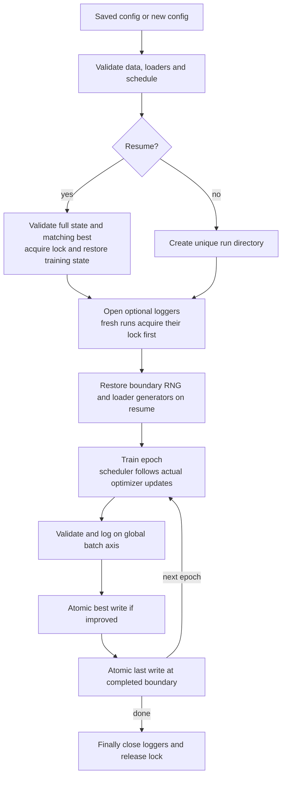

# Training, atomic checkpoints and resume (P2.1)

## Start a fresh run with a fixed plan

Choose the complete epoch budget before starting: it defines the OneCycleLR
horizon. For the locally prepared deduplicated Hugging Face data:

```bash
train-age data.csv_dir=dataset/protocol_hf_v1 \
  model.pretrained=false training.epochs=100
# Source equivalent:
python scripts/train.py data.csv_dir=dataset/protocol_hf_v1 \
  model.pretrained=false training.epochs=100
```

`model.pretrained=false` starts without downloading backbone weights. Pretrained
initialization remains available when requested. The committed default
`data.csv_dir=csv_dataset` points to historical splits with confirmed byte-duplicate
leakage; use a fresh verified protocol for a new benchmark. See
[DATA_PROTOCOL.md](DATA_PROTOCOL.md). No new full-dataset training/benchmark was
performed as part of implementing P2.1.

Every fresh run allocates a unique run ID and directory. The trainer prints its
actual checkpoint path; replace `RUN_ID` below with that value:

```text
checkpoints/RUN_ID/
  best.pt     # lowest finite validation MAE, complete boundary state
  last.pt     # latest completed epoch, complete boundary state
runs/RUN_ID/  # TensorBoard and/or W&B local files when enabled
```

`logging.save_dir` and `logging.log_dir` are roots for fresh runs. Previous runs
and historical checkpoint files are never deleted or reused by a fresh run.
Retention is one best and one last per run, not unbounded per-epoch files.

## Resume from a completed epoch

```bash
train-age --resume checkpoints/RUN_ID/last.pt
# Logging-only changes are supported:
train-age --resume checkpoints/RUN_ID/last.pt \
  logging.use_wandb=true logging.wandb_mode=offline
# Inspect the saved experiment before model/data construction:
train-age --resume checkpoints/RUN_ID/last.pt --print-config
```

The saved experiment is authoritative. A partial `--config` YAML and CLI overrides
are merged on top of it. Training hyperparameters, epoch budget, seed, model,
loss and optimizer/scheduler settings must remain compatible. Changing total
epochs is rejected rather than silently rebuilding OneCycleLR. Warm-starting a new
schedule is a separate operation, not a supported `--resume` shortcut.

Logging settings and data locations can change, provided loader/provenance checks
still match. Device identity, AMP and determinism settings must agree; a changed
runtime/package or hardware description warns that numerical equivalence is not
guaranteed. Matching config does not promise bitwise results across hardware.
Resume reconstructs the backbone with pretrained initialization disabled, then
loads saved weights: it does not download pretrained weights again.

Checkpoint output continues **beside the supplied resume file**, regardless of
`logging.save_dir`. Logs use the saved run ID under the selected `logging.log_dir`.
Keep `best.pt` and `last.pt` together when relocating a run. A last checkpoint
references its matching best epoch/metric; a missing or inconsistent best is not
silently replaced. `best.pt` itself is also resumable.

An interruption inside an epoch replays that epoch from the last completed
boundary. Exact mid-epoch continuation, prefetched worker queues, distributed
samplers, custom batching and persistent workers are unsupported. Standard
RandomSampler/SequentialSampler, default BatchSampler and
`persistent_workers=False` are checked explicitly.

## State and compatibility contract

Inference schema remains version 1. P2.1 adds an optional, separately versioned
`training_state` and retains the top-level optimizer state:

| State | Purpose |
|---|---|
| Model and loss buffers | Exact current weights and objective state |
| Optimizer | AdamW moments, step counters, parameter group LR/betas |
| Scheduler | Original OneCycle horizon and current successful-update position |
| GradScaler | Dynamic scale/growth/backoff state |
| Epoch and counters | Next epoch, attempted batches (`global_step`), successful updates |
| Best state | Best MAE and epoch, matching sibling `best.pt` |
| Python/NumPy/torch RNG | Main-process random streams; NumPy keys stored as tensors for restricted loading |
| CUDA RNG | Visible CUDA generators when CUDA training is used |
| Loader generators | Train/validation base and sampler generators, sharing relationships |
| Resume contract | Config, data provenance, device/determinism, loader shape/worker/sampler settings and ordered parameter names/shapes |
| History and environment | Completed metrics and original/resumed runtime provenance |

RNG/generator restoration happens **after** model/optimizer construction and
logger initialization, immediately before the next epoch. Canonical worker RNGs
are recreated from restored loader generator seeds at the epoch boundary.

Both checkpoint types use `torch.load(..., weights_only=True)` for resume. Raw
state_dicts, legacy pickle wrappers and older inference-only schema-v1 artifacts
lack complete state and are rejected as resumes; they remain supported for
inference under [CHECKPOINTS.md](CHECKPOINTS.md). There is no unsafe resume fallback
or fabricated optimizer/RNG history. A direct private `_save_checkpoint` call
outside a running epoch only creates an inference artifact, not a complete resume.

Data contracts use provenance from the canonical loader. Verified manifests bind
CSV and image bytes; unversioned CSVs bind current CSV hashes but do not verify
image content. Preserve the original protocol CSVs and manifests when resuming;
regenerating a manifest can change its provenance contract even if CSV rows match.
Direct custom DataLoaders without provenance can only be checked
structurally; the caller must keep sample/transform contents and independent RNG
objects unchanged. NumPy `Generator` instances or custom libraries are not captured
automatically. Repeatability is scoped to the same runtime, code, hardware,
loader/worker settings and stateless dataset/transform recipe.

## Atomic writes and failure recovery

Every checkpoint is serialized to a unique temporary file in the same directory,
flushed and fsynced, then replaced with `os.replace`. An unsuccessful serialization,
fsync or replacement preserves the old file and removes this run's temporary file.
The in-memory best metric changes only after a successful best write.

At an improving epoch, best is written first, then last. These are individually
atomic files, **not a two-file transaction or a power-loss durability guarantee**.
If last writing fails after a successful new best, last can be older than the best
it references. Resume detects the mismatch: use the newer complete `best.pt` or
restore a matching saved pair. It does not silently overwrite the newer best.
Non-improving epochs replace only last. Any training/validation/save exception
exits through logger and lock cleanup.

A `.training.lock` file is created exclusively while a run is active, preventing a
second writer to the same run directory. Normal exceptions and keyboard interrupts
release this trainer's lock. An abrupt process kill can leave a stale lock: confirm
that no trainer is running before manually removing it. Move/copy the full run
pair for portability; copied concurrent branches should use separate log roots.

## Optimizer identity and AMP scheduling

`AgeEstimationModel.head` exposes the actual replaced module without registering
it twice or changing state_dict keys. Parameter groups use object identity;
frozen parameters are excluded, every trainable parameter belongs to exactly one
group, and ViT MLP `fc1/fc2` layers remain in the backbone. MobileNet's pretrained
classifier projection also remains in the backbone; only its replaced final head
uses the head LR.

The optimizer's post-step hook counts actual updates. GradScaler can skip an
optimizer call on nonfinite gradients; the scheduler and successful-update counter
advance only if an optimizer update actually ran. `global_step` counts attempted
batches, including skips. The fixed OneCycle budget is epochs × batches per epoch;
if updates are skipped, the run can end before the scheduled final minimum LR.
No extra epochs or invented scheduler steps are added. Nonfinite losses abort
instead of publishing a successful epoch.

The post-step API is present in the [PyTorch 2.3 optimizer source](https://github.com/pytorch/pytorch/blob/v2.3.0/torch/optim/optimizer.py).
The exact minimum runtime matrix remains P3.2 work. See the
[official AMP examples](https://docs.pytorch.org/docs/stable/notes/amp_examples.html)
for scaler skip/unscale behavior.

## Independent logging

TensorBoard and W&B remain optional. Loggers initialize inside `run`, so creating
Trainer does not initialize a service or open event files. All scalar tags use the
attempted-batch global axis, including epoch metrics. TensorBoard resumes in the
run folder and purges events after the restored boundary.

```bash
train-age data.csv_dir=dataset/protocol_hf_v1 \
  logging.use_tensorboard=false logging.use_wandb=true logging.wandb_mode=offline
```

W&B creates a fresh SDK session per invocation, grouped by the logical run ID.
Each session uses the explicit `trainer/global_step` custom metric axis; it does
not depend on the remote SDK history step accepting rollback after a crash. Offline
mode writes local files without an account or upload. Both logger close methods
are attempted in `finally`; a cleanup failure is reported without masking the
training error. Run IDs isolate local files; opt-in online logging remains a user
choice. CI runs the real offline integration with the optional W&B package on
Python 3.11; the other CPU jobs may skip that extra test.



Tests compare uninterrupted and interrupted CPU training (including interruption
inside an epoch) with zero/two workers, checking exact model/optimizer/LR/scaler,
metrics and RNG continuation. They inject write/fsync/rename and logger failures,
check run isolation, contract rejection, CLI pretrained bypass, real TensorBoard
and W&B offline output, CUDA skip and CUDA Adam/scaler/RNG restoration. Synthetic
CNN checkpoints are still tested through the common inference loader. These are
correctness tests, not a UTKFace accuracy benchmark or a guarantee of cross-device
bitwise GPU training.


Local P2.1 verification: **377 tests passed**, including 58 trainer/resume cases,
four CUDA tests across the full suite, actual W&B 0.23.1 offline output and
TensorBoard event reading. Python 3.13.9 / torch 2.9.0+cu128 on the existing Conda
environment, RTX 5070 Laptop GPU. The complete suite used
`CUBLAS_WORKSPACE_CONFIG=:4096:8` before process startup. No dependency or weights
were downloaded, and no full-data experiment/benchmark was run. Remote CI is
recorded separately in [the roadmap](../audit/IMPLEMENTATION_ROADMAP.md).
